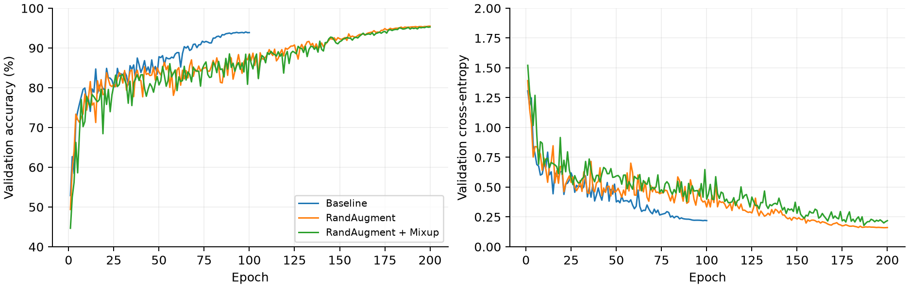

# Deep Learning Project 1

**Max Zhang · yz12020 · Fall 2026**

## Codex assistance acknowledgment

This project was completed with assistance from **OpenAI Codex**. Codex assisted with environment setup, code implementation and debugging, performance optimization, reproducibility packaging, and report drafting. Max Zhang is the sole listed team member; Codex is acknowledged as an AI assistant, not a human team member or a GitHub co-author.

A CIFAR-adapted residual network trained from scratch using only the supplied competition data, under a **5,000,000-parameter** limit. The model has **2,797,610 trainable parameters**. No pretrained weights or additional datasets are used.

- [Executed training notebook](CIFAR10_ResNet_Project.ipynb), including actual epoch logs, plots, parameter count, and validation output
- [Machine-readable results](results/experiment_summary.csv) and [verification audit](results/audit.json)

The project report is submitted separately through Brightspace and is intentionally not included in this repository.

## Results: validation is not Kaggle test accuracy

| Training experiment | Epochs | Parameters | Best epoch | Validation accuracy |
| --- | ---: | ---: | ---: | ---: |
| Crop/flip baseline | 100 | 2,797,610 | 98 | 94.04% |
| RandAugment | 200 | 2,797,610 | 200 | **95.50%** |
| RandAugment + Mixup | 200 | 2,797,610 | 198 | 95.34% |

All use the same 45,000/5,000 stratified split and seed 42. These local values were recomputed from their saved best checkpoints; they are **not** held-out competition scores.

| Author-confirmed Kaggle submission | Public score | Private score |
| --- | ---: | ---: |
| RandAugment, single view | 0.83000 | 0.81400 |
| RandAugment, horizontal-flip TTA | **0.84800** | **0.83100** |
| RandAugment + Mixup, horizontal-flip TTA — latest | 0.84300 | 0.82800 |

TTA averages **softmax probabilities** from the original and horizontally flipped image. It is not logit or hard-label averaging. The saved RandAugment and Mixup submissions both match recomputed TTA predictions exactly. Public and private scores concern different hidden subsets and are not combined. The screenshot marks the visible submissions **after deadline**: this repository reports observed scores, not an official competition rank or eligibility claim. See the [score record](results/kaggle_scores.json) and [screenshot](assets/figures/kaggle_submissions.png).



## Architecture and training

The network uses a 3×3 stride-1 stem, four stages of two residual blocks with widths 32/64/128/256, global average pooling, and a ten-class linear classifier. Transition blocks use stride-2 projected skips. [model.py](model.py) exposes the same architecture and checkpoint keys as the executed notebook.

Shared settings: SGD, learning rate 0.1, momentum 0.9, weight decay 0.0005, cosine learning-rate decay, training batch 128, validation batch 256, CUDA AMP, seed 42. The baseline uses random crop and horizontal flip. The stronger presets add RandAugment (`num_ops=2`, `magnitude=9`); Mixup also uses one `Beta(0.2,0.2)` draw per batch. Checkpoint selection uses validation accuracy only.

Only width 32 was completed. Baseline versus RandAugment changes both duration and augmentation, so the 1.46-point gain is not a clean augmentation-only ablation. Mixup's logged training accuracy is weighted mixed-label agreement and is not directly comparable with clean-label training accuracy. Historical JSON configurations omit augmentation/TTA fields; presets reconstruct those from retained source and author-confirmed run history. The RandAugment-only source snapshot was not separately retained, so its exact historical provenance is less complete than the executed Mixup run. New reproductions save their additional settings in a sidecar file.

## Setup

The tested environment is Windows, Python 3.11.9, RTX 4080, PyTorch 2.11.0+cu128 and torchvision 0.26.0+cu128. Version pins describe the recorded environment, not a universal platform recommendation.

```powershell
git clone https://github.com/MogulZH/Deep-Learning-Project1.git
cd Deep-Learning-Project1
py -3.11 -m venv .venv
.\.venv\Scripts\python.exe -m pip install -r requirements-cuda.txt
.\.venv\Scripts\python.exe -m pip install -r requirements.txt
```

Place the course-supplied `data.zip` beside the notebook. The first data cell extracts it to:

```text
data/
  train_labels.csv        # id, filename, label
  test.csv               # id, filename
  sample_submission.csv  # id, label
  train_images/          # 50,000 RGB PNGs
  test_images/           # 2,000 RGB PNGs
```

Dataset files and trained binary checkpoints are intentionally not uploaded. To use a different extracted data directory, supply `--data-dir PATH`. The original checkpoints remain available locally to the author for verification; a fresh clone can regenerate them by training. Output is kept under `outputs/reproduced/`, separate from archived results.

## Reproduce training

Start with a pipeline check; this is not a final accuracy experiment:

```powershell
.\.venv\Scripts\python.exe reproduce.py --experiment baseline --smoke
.\.venv\Scripts\python.exe reproduce.py --experiment randaugment --smoke --tta
.\.venv\Scripts\python.exe reproduce.py --experiment mixup --smoke --tta
```

Then run full experiments as needed:

```powershell
.\.venv\Scripts\python.exe reproduce.py --experiment baseline
.\.venv\Scripts\python.exe reproduce.py --experiment randaugment --tta
.\.venv\Scripts\python.exe reproduce.py --experiment mixup --tta
```

The command executes the archived notebook's code with explicitly selected settings; it does not overwrite notebook outputs or historical results. With unchanged settings, rerunning resumes the last completed epoch. A different setup or source requires a different `--output-root`; experiment-specific metadata prevents silently resuming a different preset. Smoke and full runs use different folders. The dataset is cached as raw uint8 pixels, not cached random augmentations.

For interactive inspection, open the executed notebook in VS Code and select this checkout's `.venv` interpreter. Do not run every cell merely to inspect the retained results: the notebook defaults to the full 200-epoch Mixup experiment. Use the CLI smoke preset for a short test.

## Generate predictions with an existing checkpoint

Only load checkpoints that you trained or otherwise trust:

```powershell
.\.venv\Scripts\python.exe predict.py --checkpoint outputs/reproduced/randaugment/best.pt --tta --output outputs/submission_tta.csv
.\.venv\Scripts\python.exe predict.py --checkpoint outputs/reproduced/randaugment/best.pt --output outputs/submission_single_view.csv
```

Predictions are matched to the exact sample-submission ID order. This command prints the parameter count; test accuracy cannot be computed locally because hidden labels are not supplied. Print the externally measured Kaggle results separately with:

```powershell
.\.venv\Scripts\python.exe summarize_results.py
```

## Execution evidence

The executed notebook and result files support the methodology, model architecture, local learning curves, validation confusion matrices, and distinction between the latest and best Kaggle submissions. The report PDF and its source files are kept separately, not published here.

Small historical artifacts and prediction files are retained under `results/`; the shared split indices permit checking the exact data partition. `results/audit.json` records best-checkpoint hashes, recomputed validation, and whether archived CSVs match single-view or flip-TTA inference. Package SHA-256 checksums are in `MANIFEST.sha256`. The archived notebook preserves real execution output; machine-specific output paths were redacted, not replaced by generated training logs.

No multi-seed significance, architecture-width superiority, hidden-test confusion matrix, official rank, or controlled T4-versus-4080 speed claim is made. The earlier speed optimization was tested on a baseline loop and is not a benchmark of the current Mixup loop. The OpenAI Codex assistance is acknowledged above; measured results are supported by saved artifacts.

## References

- He et al. [Deep Residual Learning for Image Recognition](https://arxiv.org/abs/1512.03385), CVPR 2016.
- Cubuk et al. [RandAugment](https://arxiv.org/abs/1909.13719), 2019 preprint.
- Zhang et al. [mixup: Beyond Empirical Risk Minimization](https://arxiv.org/abs/1710.09412), ICLR 2018.
- PyTorch [Performance Tuning Guide](https://docs.pytorch.org/tutorials/recipes/recipes/tuning_guide.html).
- Course assignment: *Deep Learning Project 1*, Fall 2026; author-supplied Kaggle submission evidence.
